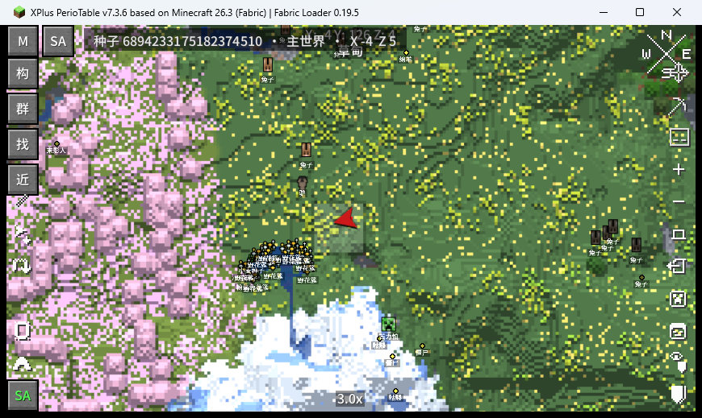

# Seed Atlas · 种子地图(26.3 Fabric)

在 Xaero 世界地图上看种子生成的群系和结构,右键任意结构能翻出它内部的每一块、每个箱子、以及箱子里的战利品预测。

把 [美西螈启动器](https://axlmc.org/) 那套"种子地图"搬进游戏里,基于 [DUzzL/Seed-Atlas](https://github.com/DUzzL/Seed-Atlas) 的生成引擎扩写。



## 它能干什么

| 功能 | 说明 |
| --- | --- |
| 群系图层 | 按种子铺色,覆盖 Xaero 世界地图;可选单个群系高亮 |
| 结构图标 | 29 类结构标在地图上,点图标可建路径点、复制坐标 |
| **结构详情** | 右键结构 → 分割图(结构块/坐标)、箱子清单、战利品预测(物品 + 数量 + 附魔等级) |
| 最近搜索 | 从当前位置找最近的指定结构 / 指定群系 |
| 三张地图 | 主世界、下界、末地各自独立种子(支持每个维度单独设) |
| **种子输入** | 点地图顶部的种子条、或设置页里的「种子」按钮,数字或任意文本都能填 |
| **反推种子** | 装 SeedCrackerX(可选)后,页内显示收集进度,凑满自动破解并填回种子 |
| 全中文 | 物品名走游戏自带翻译;附魔、战利品表、群系名内置中文 |
| 版本过滤 | 引擎里 1.17 及更早的老群系(Badlands Plateau、`*_Hills`)按当前版本注册表剔除,不列无效项 |

## 依赖

- Minecraft **26.3**(Fabric)
- Fabric Loader **≥ 0.19.5**
- **Java 25**
- Fabric API
- [Xaero's World Map](https://modrinth.com/mod/xaeros-world-map) **≥ 1.47.0**
- ~~SeedCrackerX~~ —— **已内置在这个 jar 里**,不需要单独安装,也**不要**再往 mods 里放第二份

纯客户端模组,服务器不需要装。

## 安装

把 jar 丢进 `mods/` 即可。和 Xaero 的小地图/世界地图共存,不需要额外配置。

## 用法

按 `M` 打开世界地图,左侧有四个无边框的字(鼠标悬停有提示):

| 字 | 功能 |
| --- | --- |
| 构 | 结构开关 —— 决定哪些结构显示在地图上 |
| 群 | 群系高亮 —— 选群系,地图上铺色 |
| 找 | 最近的结构 —— 从当前位置搜索 |
| 近 | 最近的群系 —— 从当前位置搜索 |

四个字会自动避让 Xaero 已有的按钮位置,换分辨率也不会压在一起。

地图上**右键结构图标 → 结构详情**:

```
要塞 · 135 块 · 9 箱
  ▸ SHLi   -667 -1504
    ▣ 要塞图书馆   @-668 -1499
         书 ×2
         书 ×3
         眼眸盔甲纹饰锻造模板 ×1
         附魔书 ×1  [锋利 3]
```

左栏 11 类结构点击切换,右栏层级列表滚轮滚动,底部「复制坐标」。

点顶部那条 **种子 …· 主世界 · X … Z …** 就能改种子:输入数字或任意文本都行,确认后群系和结构立刻按新种子重铺。在哪个维度点的就只改哪个维度;主世界的种子同时给没有单独设置的下界和末地使用(末地/下界改过之后,界面里还能一键改回跟随主世界)。

单人存档自动读取种子;多人服务器按 Xaero 的服务器上下文分别保存。

### 不知道种子怎么办(可选)

装 [SeedCrackerX](https://github.com/19MisterX98/SeedCrackerX)(MIT,同样支持 26.3)后,种子界面下方会多出两条进度条:

- **常规 x/32**、**抬升 x/40** —— 正常跑图,走到沉船、沙漠神殿、冰屋、丛林神庙、沼泽小屋、前哨站附近就会自动记录
- 两边都满了它会自己开始破解,一般 1～5 分钟;破解结果自动填进种子输入框,不用手动抄
- 同一个页面上写着这三步,不用记命令;收集出错时页面里有「清空已收集的结构数据」

SeedCrackerX(MIT)已经打在这个 jar 里,装一个文件就有全部功能;它的许可证随包附带。

## 结构详情的覆盖面

只对上游引擎有 pieces 且有战利品盐值的结构给预测,**没数据的类型在菜单里置灰,不编造**。

| 有战利品预测(11) | 无战利品盐值(2) | 无内部生成器(9) |
| --- | --- | --- |
| 要塞、末地城、下界要塞、堡垒遗迹、沙漠神殿、丛林神庙、沉船、掠夺者前哨站、废弃传送门、埋藏的宝藏、雪屋 | 女巫小屋、废弃营地 | 试炼密室、远古城市、林地府邸、海底神殿、村庄、废弃矿井、沙漠水井、紫晶洞 |

结构块名仍是 cubiomes 内部代号(`SHLi` = 要塞图书馆、`SHCC` = 十字路口),不是给人看的名字,暂未翻译。

## 构建

需要 JDK 25:

```bash
./gradlew build
# 产物:build/libs/seedatlas-xaero-<版本>-mc26.3-fabric.jar
```

原生库(群系/结构/战利品算法)已经编译好放在 `common/src/main/resources/natives/windows-x86_64/`,普通构建不需要 C 工具链。

要改 C 层,见 [`native/README.md`](native/README.md):`sax_detail.c`(结构分割 + 战利品)、`sax_ore.c`(矿层扫描)、`seedatlas_xaero.dll`(上游引擎),通过 Java FFM 调用,ABI 在 `sax_detail.h` / `sax_ore.h` 里固定。

目前只带 Windows x86_64 原生库。

## 已知限制

- **附魔书上的附魔只是预测**:战利品引擎自己掷附魔,和游戏 `EnchantmentHelper` 的随机数消耗点有差异,实测会落到另一种附魔(例如预测锋利 3、实际保护 3)。面板里已标注「预测(可能不准)」,物品与数量不受影响
- 只支持原版正常世界和 Large Biomes 生成;自定义世界生成数据包、模组维度不支持
- 物品小图标未做(要构造 `ItemStack` 并改可变行高)
- 结构块代号未汉化(见上)
- 原生库只有 Windows x86_64

## 许可与致谢

本项目按 **GPL-3.0** 发布,完整条款见 [`LICENSE`](LICENSE)。

- 生成引擎与图标:[DUzzL/Seed-Atlas](https://github.com/DUzzL/Seed-Atlas)(GPL-3.0,commit `fc2c628`),源自 [Cubitect/cubiomes-viewer](https://github.com/Cubitect/cubiomes-viewer)
- 算法底层:[cubiomes](https://github.com/Cubitect/cubiomes)(MIT)与 [xpple/cubiomes](https://github.com/xpple/cubiomes)(`loot/` 与 `features/ore.c`)
- 地图宿主:[Xaero's World Map](https://modrinth.com/mod/xaeros-world-map)

详见 [`THIRD_PARTY_NOTICES.md`](THIRD_PARTY_NOTICES.md) 与 [`LEGAL_NOTICE.md`](LEGAL_NOTICE.md)。

本模组是独立扩展,不是 Xaero 的官方发布,也与 Mojang / Microsoft 无关。

---

## English

A client-side Fabric mod for **Minecraft 26.3** that renders [Seed Atlas](https://github.com/DUzzL/Seed-Atlas)
biomes and structure markers in Xaero's World Map, and adds a structure inspector: right-click
any structure to see its pieces, chests and **predicted loot** (items, stack sizes, enchantments).

Requires Fabric API and Xaero's World Map ≥ 1.47.0 (Java 25, Loader ≥ 0.19.5). Client-side only.

Left column shows four labels (no button chrome, auto-placed below Xaero's own buttons):
structure toggles, biome highlight, nearest structure, nearest biome. Click the seed bar along the
top edge to type a seed (number or any text); it applies to the dimension the map is showing, and
the Overworld seed also generates every dimension without its own. SeedCrackerX (MIT) is bundled
inside this jar: the same screen shows how many structure bits it has collected and fills in the
seed by itself once it cracks, so a single file installs everything. Do not add a second copy of
SeedCrackerX to the mods folder.

Loot prediction covers 11 structures that upstream generates pieces and loot salt for; types
without data are greyed out rather than filled with guesses.

Licensed **GPL-3.0**. Engine and icons from DUzzL/Seed-Atlas, algorithms from cubiomes (MIT).
Not an official Xaero release.
